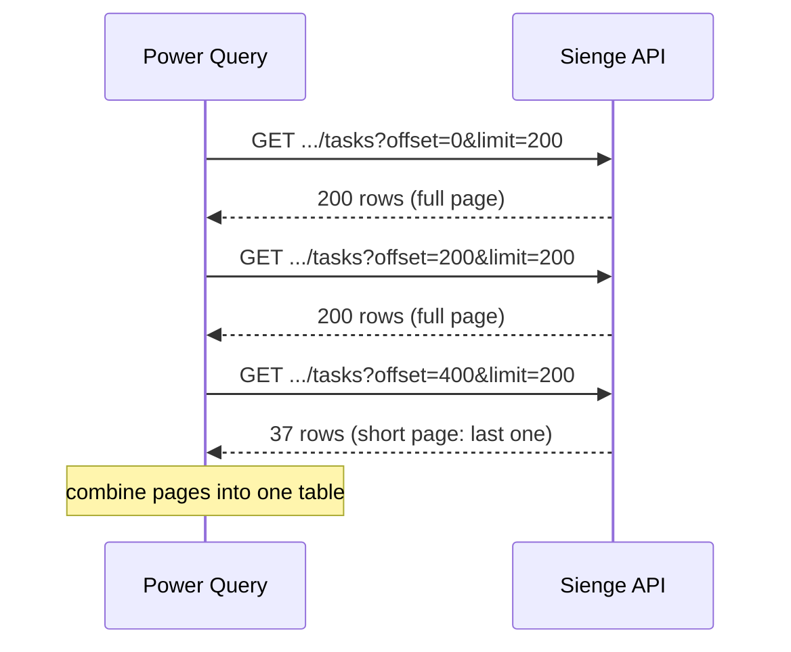

# 🏗️ Sienge API → Power BI: paginated load in Power Query

[Sienge](https://www.sienge.com.br/) is an ERP used by many Brazilian construction companies. Its public API returns at most **200 records per request**, so loading a full schedule, budget or list of contracts into Power BI requires pagination.

This repository has one Power Query (M) query that loads **all** the tasks of a building project's schedule, page by page, and refreshes in the Power BI Service. It came from using Sienge data in construction planning, where a schedule easily has more than 1,000 tasks.

## How it works



`List.Generate` keeps requesting while the previous page came full and stops at the first short page. The total does not have to be known in advance.

## Usage

1. In Power Query, create three parameters (*Home → Manage Parameters*): `SiengeSubdomain` (text), `ProjectId` (number), `SheetId` (number).
2. Create a blank query, open the *Advanced Editor* and paste [`powerquery/SiengeTasks.pq`](powerquery/SiengeTasks.pq).
3. On the first run, choose **Basic** authentication for `api.sienge.com.br` with the API user and password. Credentials stay in Power BI, never in the code.

For another endpoint (budgets, contracts, bills), change only `Path`: the pagination is the same.

## What changed from the first version

The [first version](powerquery/v1_original.pq) (2025) worked as an example, but had four problems that only show up with real data:

| Problem | Effect | Fix |
|---|---|---|
| The URL had `?offset=0&limit=200` hard-coded **and** `Query=[offset=...]` added another `offset` | the request carries two `offset` parameters; depending on how the server resolves duplicates, every page can return the **same first 200 records** | `offset` and `limit` only in `Query` |
| A fixed bound: `List.Generate(() => 0, each _ < 1600, ...)` | above 1,600 records, rows are silently lost; below it, useless requests | stop at the first short page |
| `try GetAPIData([Offset]) otherwise null` | an authentication error (401) or a rate limit becomes an empty page and the report shows fewer rows **without any error** | no `try`: an API error fails the refresh |
| The whole URL built as text | the Power BI Service flags it as a *dynamic data source* and does not allow scheduled refresh | static base URL + `RelativePath` + `Query` |

> The corrected query follows the documented behavior of `Web.Contents` and `List.Generate`. It was not re-tested against a live Sienge instance for this repository. If your endpoint has a different page size, change `PageSize`.

## Files

```
powerquery/
├── SiengeTasks.pq      # the query to use
└── v1_original.pq      # first version, for comparison
```

---

**Rodrigo Jacques Wolff** · Civil engineer → Analytics Engineer · [LinkedIn](https://www.linkedin.com/in/rodrigo-jacques-wolff/)
